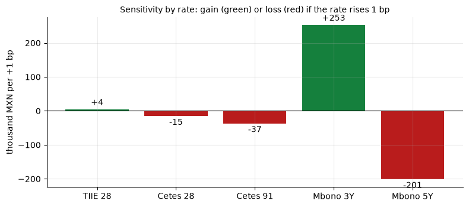
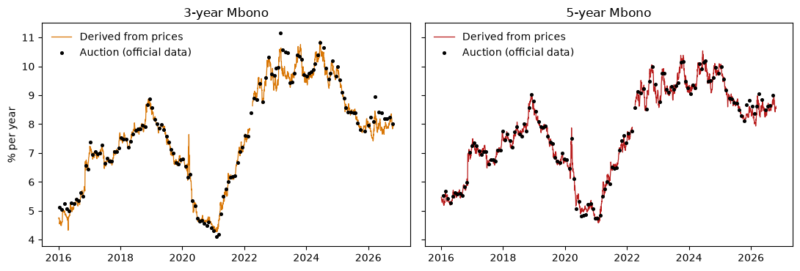
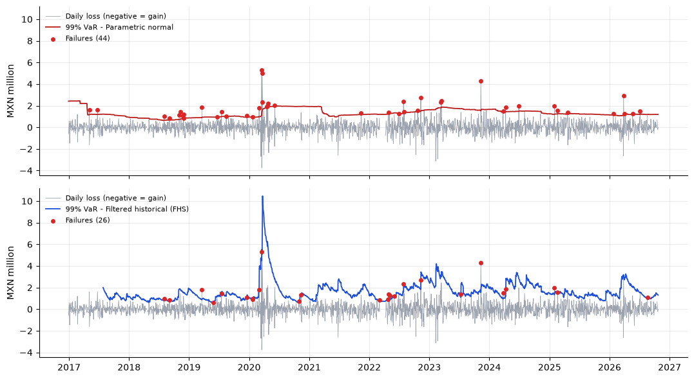
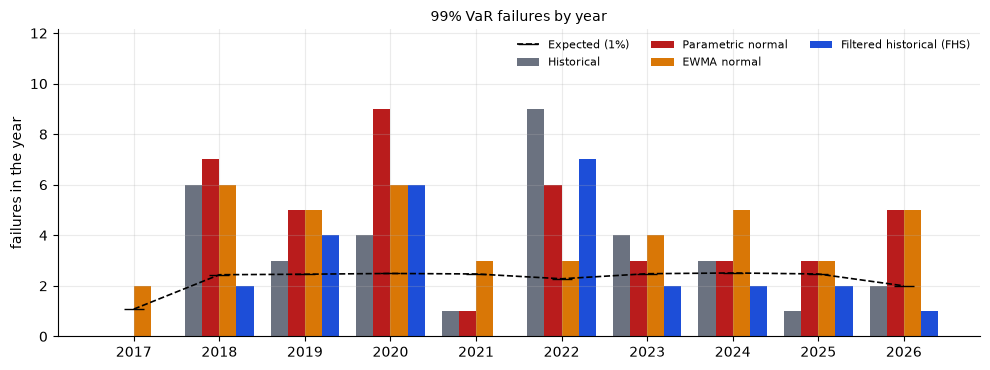

# Interest-rate market risk of a treasury: VaR, Expected Shortfall and backtesting

Measures the interest-rate risk of a **hypothetical** treasury portfolio (government securities, TIIE-linked debt and a hedging swap) with public data from Banco de México's Economic Information System (SIE), 2016–2026. It compares four methods for 1-day Value at Risk (VaR) and Expected Shortfall (ES) and tests them with backtesting.

*Mexican instruments used: **Cetes** (Treasury bills), **Mbonos** (fixed-rate government bonds) and **TIIE 28** (the 28-day interbank rate, the reference for floating-rate debt and swaps).*

> **Disclaimer.** The portfolio is illustrative: amounts and terms are assumptions, not data from any institution. What the banking regulator (CNBV) requires is **to be verified**, and this project does not claim to meet it.

## The portfolio

| Position | Side | Notional (MXN mm) | Sensitivity (thousand MXN per +1 bp) |
|---|---|---|---|
| Cetes 28-day | Asset | 2,000 | −15 |
| Cetes 91-day | Asset | 1,500 | −37 |
| 3-year Mbono | Asset | 1,000 | −265 |
| 5-year Mbono | Asset | 500 | −201 |
| Debt at TIIE 28 + 0.40% | Liability | 3,000 | +12 |
| Swap (pays fixed 8.20%, receives TIIE 28) | Derivative | 2,000 | +509 |
| **Total** | | | **+3.5** |



If all rates rise 1 basis point at once, the portfolio barely changes in value. But each rate weighs differently: it **gains if the 3-year rate rises and loses if the 5-year rate rises**. Its main risk is a change in the **slope** of the curve between 3 and 5 years.

## 3- and 5-year Mbono yields

Banxico does not publish a daily constant-maturity yield for Mbonos. It is derived from the price vector: the yield to maturity of each reference bond is computed and interpolated to a constant maturity. Compared with the yield of the official auctions, the difference is a few basis points at the median.



## Results

### 1-day VaR and ES (23-Oct-2026, MXN million)

| Method | VaR 95% | ES 95% | VaR 99% | ES 99% |
|---|---|---|---|---|
| Historical (250 days) | 0.75 | 1.21 | 1.28 | 2.04 |
| Parametric normal (250 days) | 0.84 | 1.05 | 1.19 | 1.36 |
| EWMA normal (λ = 0.94) | 0.55 | 0.69 | 0.78 | 0.89 |
| Volatility-filtered historical (FHS) | 0.72 | 1.08 | 1.32 | 1.48 |

### Backtesting at 99% (2,268 days, the four methods on the same sample)

A 99% VaR should fail on 1 day in 100 (22.7 failures expected). *Kupiec* tests whether the number of failures is the expected one; *Christoffersen*, whether they come in clusters. A p-value below 0.05 rejects the method.

| Method | Failures | Kupiec p | Independence p | Conditional coverage p | Loss at failure / ES |
|---|---|---|---|---|---|
| Historical | 33 | 0.041 | 0.085 | 0.035 | 1.07 |
| Parametric normal | 42 | < 0.001 | 0.044 | < 0.001 | 1.30 |
| EWMA normal | 42 | < 0.001 | 0.221 | 0.001 | 1.26 |
| **Volatility-filtered historical (FHS)** | **26** | 0.494 | 0.283 | 0.421 | ≈ 1.00 |



*The chart counts failures from the first VaR of each method (44 and 26); the table counts only the common sample (42 and 26).*



**Reading the results**

- Methods with a **normal distribution understate the tails**: they fail almost twice as often as expected and, when they fail, lose more than the ES predicts.
- **Reacting to volatility** (EWMA, FHS) removes clusters of failures; **using historical scenarios** (historical, FHS) fixes the tails. FHS combines both and is the only method that is not rejected by any test.
- The **historical method is borderline**: Kupiec (0.041) and conditional coverage (0.035) reject it narrowly. With several tests run at once, a rejection like this should be read with caution.
- None of this **proves** that FHS is better than the historical method: the difference is small (26 failures against 33), its mean VaR is higher, and the result depends on λ, which was not calibrated.

## Method

1. **Data:** SIE rates (TIIE 28, Cetes 28, 91 and 364) and the Mbono price vector, in `data/sie_series.csv`.
2. **Daily changes** in basis points, never filling missing days. Days when the reference bond changes and four Cetes 28 outliers are excluded.
3. **Portfolio:** valuation of each position and sensitivity by rate (central difference of ±1 bp).
4. **1-day VaR and ES:** loss of today's portfolio using the changes of the last 250 business days; each day is computed with prior information only.
5. **Backtesting:** a failure is a day when the loss exceeds the VaR; streaks are cut where data is missing.

## Limitations

- **Swap basis risk is not captured.** The swap is valued with the Mbono curve because the TIIE swap curve is not public. Each basis point of divergence between the two curves is worth about MXN 0.5 million, several times the 1-day VaR. Stress tests to size it are pending.
- Loss is **linear** in rate changes and today's portfolio is applied to the whole history (hypothetical P&L).
- **EWMA λ is not calibrated.**
- With ~23 failures expected at 99%, the tests have low power.

## How to run

```bash
pip install -r requirements.txt
python treasury_risk.py     # VaR, ES, backtesting; tables in results/, charts in figures/
python mbonos.py            # optional: only the Mbono yield derivation
```

## Structure

```
mbonos.py             derives the 3- and 5-year Mbono yields from prices
treasury_risk.py      portfolio, sensitivities, VaR/ES (4 methods) and backtesting
portfolio.yaml        illustrative portfolio
data/sie_series.csv   SIE series used
figures/              charts
```

**Data source:** Economic Information System (SIE), Banco de México, https://www.banxico.org.mx/SieInternet/ (retrieved 23-Oct-2026). The 3- and 5-year Mbono yields, the daily changes and all results are the author's own calculations; Banco de México does not endorse them, and takes no responsibility for the accuracy of its information or for its use by third parties; published figures may differ from final data.
